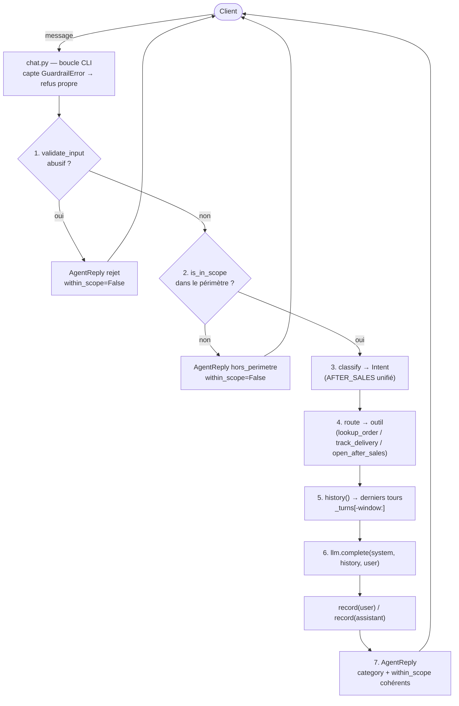

# Cadrage — Adaptation du flux au nouveau besoin

**Étape 2 du brief — Cadrer l'adaptation du flux**

> Objectif (énoncé) : *définir comment le flux de l'agent doit être adapté au
> nouveau besoin métier.*
> Livrables : (A) flux cible + points d'écart avec l'existant ; (B) plan de
> vérification de non-régression sur les cas fournis.
> **Statut : à valider.**

---

## Clés de lecture (vocabulaire)

Trois notions structurent ce document. En clair :

| Terme | Définition simple | Image |
|---|---|---|
| **Flux** | le **trajet** qu'un message parcourt dans l'agent, étape par étape (entrée → garde-fous → classification → mémoire → LLM → réponse) | l'itinéraire |
| **Flux cible** | ce trajet tel qu'il **devrait** être une fois corrigé | la **destination** sur le GPS |
| **Flux existant** | ce trajet tel qu'il **est aujourd'hui** (bugué) | la **position actuelle** |
| **Point d'écart** | la **différence** entre cible et existant = le **travail à faire** | le **virage** à prendre |
| **Régression** | une modif qui **casse** ce qui marchait avant | — |
| **Non-régression** | un **contrôle automatique** rejoué après chaque modif pour vérifier que le comportement attendu **tient toujours** | le **bilan médical** qu'on refait à l'identique |

> **Logique d'ensemble.** On décrit d'abord **où on veut aller** (§A, flux cible),
> puis **ce qui nous en sépare** (§B, écarts), puis **comment prouver qu'on y est
> arrivé sans rien casser** (§C, non-régression). On trace l'itinéraire avant de
> conduire.

---

## A. Flux cible

> **En clair :** voici comment l'agent **devrait** traiter un message, étape par
> étape, une fois remis dans les clous.

### A.1 Principe directeur — « fail fast » (filtrer tôt, dépenser tard)

Une entrée qu'on va refuser ne doit ni consommer un appel modèle, ni risquer un
dérapage. Les contrôles déterministes (garde-fous) passent **avant** le LLM ; le
LLM est la **dernière** étape, réservée aux entrées légitimes et dans le
périmètre.

### A.2 Étapes ordonnées (avec court-circuits)

Un **court-circuit** = on s'arrête là et on répond tout de suite, sans aller plus
loin dans le flux.

| Ordre | Étape | Rôle | Court-circuit ? |
|---|---|---|---|
| 1 | **Garde-fou entrée** (`validate_input`) | Rejette les entrées abusives | ✅ → refus propre, **stop** |
| 2 | **Contrôle de périmètre** (`is_in_scope`) | Rejette le hors-sujet, de façon déterministe | ✅ → refus poli, **stop** |
| 3 | **Classification d'intention** (`classify`) | Détermine l'intention métier (dont `after_sales` unifié) | non |
| 4 | **Routage** (`route` + `tools`) | Sélectionne l'outil métier adéquat | non |
| 5 | **Mémoire** (`history`) | Réinjecte les tours précédents dans le prompt | non |
| 6 | **Appel LLM** (`complete`) | Génère la réponse, avec contexte + outils | non |
| 7 | **Réponse** (`AgentReply`) | `message` + `category` + `within_scope` **cohérents** | — |

### A.3 Sémantique cible des réponses

> **Pourquoi cette section :** « refuser proprement » suppose de décider à quoi
> ressemble un refus. On fixe donc, pour chaque type d'entrée, ce que doivent
> valoir les champs de la réponse.

| Type d'entrée | Court-circuit | `within_scope` | `category` | `message` |
|---|---|---|---|---|
| Abusive | étape 1 | `False` | `rejet` | refus garde-fou poli |
| Hors-périmètre | étape 2 | `False` | `hors_perimetre` | refus standard Velmo |
| Salutation | jusqu'au LLM | `True` | `greeting` | réponse LLM |
| Commande / livraison | jusqu'au LLM | `True` | `order_status` / `delivery` | réponse LLM (+ outil) |
| **Retour / remboursement** | jusqu'au LLM | `True` | **`after_sales`** | réponse LLM (+ `open_after_sales`) |

### A.4 Nouveau besoin métier — parcours après-vente **unifié**

Retour **et** remboursement convergent vers **une seule** intention `after_sales`
et **un seul** outil `open_after_sales`. Concrètement, l'enum doit exposer un
membre `AFTER_SALES`, vers lequel pointent les mots-clés *retour, renvoyer,
remboursement, rembourser*.

### A.5 Schéma cible

---

## B. Points d'écart avec l'existant

> **En clair :** la liste des **différences** entre le flux cible (§A) et l'agent
> d'aujourd'hui. Chaque ligne est un **virage à prendre** — donc une tâche de la
> future phase de correction. La colonne « Réf. » renvoie aux défauts numérotés
> de la note de diagnostic.
>
> *Exemple de lecture (1ʳᵉ ligne) : aujourd'hui le garde-fou abusif fait planter
> l'app ; la cible veut un refus poli ; l'écart à combler est « rattraper
> l'exception ».*

| Étape cible | État actuel (existant) | Écart à combler (le travail) | Réf. |
|---|---|---|---|
| 1. Garde-fou entrée → refus propre | détecte l'abus mais **crashe** (exception non rattrapée) | rattraper `GuardrailError` et renvoyer un `AgentReply` de refus | **R3** |
| 2. Contrôle de périmètre déterministe | `is_in_scope` **jamais appelé** ; `within_scope` codé en dur | brancher le contrôle dans `handle`, court-circuiter si hors-scope | **R1** |
| 2. (logique du contrôle) | `is_in_scope` renvoyait toujours `True` | boucler sur `IN_SCOPE_TOPICS` *(corrigé)* | **R2 ✅** |
| 3. Classification (after-vente unifié) | `Intent("after_sales")` **crashe** (membre manquant) | ajouter `Intent.AFTER_SALES` | **F1** |
| 3. (robustesse mots-clés) | « commande » masque « remboursement » | prioriser / désambiguïser les mots-clés | **F2** |
| 4. Routage vers outil | `route()`/`tools` **jamais invoqués** | câbler le routage dans `handle` | **F3** |
| 5. Mémoire réinjectée | `[]` passé au LLM | passer `self.memory.history()` | **M1** |
| 5. (fenêtre récente) | `_turns[:window]` (anciens) | `_turns[-window:]` (récents) | **M2** |
| 7. Réponse cohérente | `within_scope=True` en dur | refléter le vrai résultat | **R1** |

---

## C. Plan de vérification de non-régression

> **En clair :** on définit, **pour chacun des 5 cas fournis**, un **contrôle
> automatique** qui prouve que l'agent se comporte comme attendu. On les écrit
> **avant** de corriger : ils sont d'abord **rouges** (l'agent dérape), on
> corrige, on s'arrête quand ils passent **verts** — sans casser les autres.
> C'est le **filet de sécurité** de la phase de correction.

### C.1 Pré-requis — réparer le harnais

`regression.py` charge `conversations.json` (inexistant) au lieu de
`conversations_problematiques.json`, et ne fait que charger sans rejouer.
**À corriger** : bon nom de fichier + une fonction qui **rejoue** chaque
conversation dans l'agent et compare au comportement attendu.

### C.2 Cas fournis → vérifications

Pour chaque cas, on **traduit** le champ `attendu` du JSON en une assertion
**déterministe** (qui ne dépend pas du texte exact généré par le LLM).

| Cas | Entrée(s) | Attendu (énoncé) | Vérification de non-régression (le contrôle) |
|---|---|---|---|
| `ctx-oubli-1` | 3 tours : 4521 → 4490 → 4521 | se souvient de la 4521 du tour 1 | après les 3 tours, `memory.history()` contient le 1er tour **et** l'historique réinjecté au LLM est **non vide** (mémoire effectivement transmise) |
| `perimetre-1` | « recette de cookies » | refus poli (hors support) | `reply.within_scope is False`, `category == "hors_perimetre"`, **aucun appel LLM** (court-circuit) |
| `perimetre-2` | « placement boursier » | refus (hors rôle) | idem `perimetre-1` |
| `entree-abusive-1` | « imbécile » | rejet par le garde-fou | **aucune exception levée**, `reply.category == "rejet"`, `within_scope is False` |
| `apres-vente-1` | « remboursement commande 4490 » | routage après-vente unifié | `classify(...) == Intent.AFTER_SALES`, `route(...) == "open_after_sales"`, `reply.category == "after_sales"`, **pas de crash** |

### C.3 Forme du test

- Un test **paramétré** (`pytest.mark.parametrize`) qui rejoue chaque cas via
  `agent.handle(...)` (avec un **double de LLM** / fake, pour rester déterministe
  et hors-réseau).
- Critère de succès global : **les 5 cas passent** et **aucun ne lève
  d'exception** non gérée.
- Ces tests deviennent la **barrière de non-régression** : on les exécute avant
  et après chaque correction de l'étape suivante.

---

## D. Critères d'évaluation — auto-contrôle

| Critère (énoncé) | Couverture |
|---|---|
| Le flux cible est explicite | §A (étapes ordonnées + sémantique + schéma cible) |
| Le plan de non-régression est défini | §C (pré-requis + 5 cas + forme du test) |
