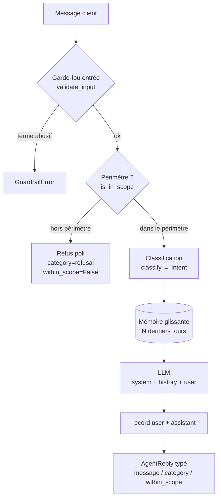

# Note de diagnostic — Agent Velmo

> Analyse des conversations problématiques fournies (`data/conversations_problematiques.json`).
> Objectif : distinguer les **défauts de mémoire** des **sorties de rôle**, avant correction.

## 1. Périmètre du problème

Deux familles de défauts, indépendantes :

| Famille | Symptôme client | Localisation |
|---|---|---|
| **Mémoire** | « il oublie ce que j'ai dit 2 messages plus tôt » | `memory.py`, `agent.py` |
| **Rôle / périmètre** | « il sort de son rôle, accepte des entrées douteuses » | `scope.py`, `guardrails.py`, `agent.py` |

À cela s'ajoute une **évolution métier** (retours + remboursements → parcours unique *après-vente*), traitée dans `flow.py`.

## 2. Défauts de mémoire

- **Fenêtre inversée** — `memory.history()` renvoyait les tours les **plus anciens** (`[:window]`) au lieu des plus récents. Passé la fenêtre, les nouveaux messages n'étaient plus jamais vus.
- **Historique jamais transmis** — `agent.handle()` appelait le LLM avec une liste vide (`complete(system, [], user)`). Même une mémoire correcte n'atteignait pas le modèle.

→ Cas `ctx-oubli-1` : l'agent perdait la commande `4521` du premier tour.

## 3. Sorties de rôle

- **Périmètre non vérifié** — `is_in_scope()` n'était **jamais appelée** dans l'agent.
- **`is_in_scope()` défaillante** — comparait les mots du message contre eux-mêmes → toujours `True`.
- **Filtre d'entrée trop faible** — refus seulement si le message *est exactement* l'insulte (`term == lowered`).
- **Sortie non contrainte** — `AgentReply.category` acceptait n'importe quelle chaîne.

→ Cas `perimetre-1/2` (recette, bourse) et `entree-abusive-1` passaient au travers.

## 4. Schéma de l'agent (flux + mémoire + garde-fous)

## 5. Flux cible (évolution métier)

- Intentions : `GREETING`, `ORDER_STATUS`, `DELIVERY`, **`AFTER_SALES`** (fusion `RETURN` + `REFUND`).
- Routage : `after_sales → open_after_sales`.
- Non-régression : rejeu de `conversations_problematiques.json` (`regression.py`) + suite `pytest` au vert (21 tests).

## 6. Critères de sortie

- [x] Périmètre mémoire vs rôle explicite.
- [x] Schéma produit (ci-dessus).
- [x] Flux cible défini + plan de non-régression (tests).
