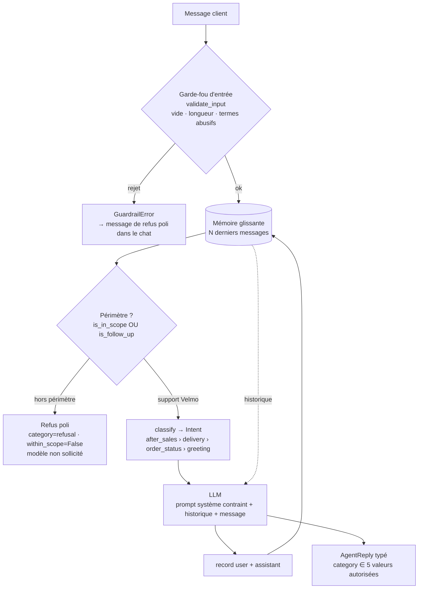

# Note de diagnostic — Agent Velmo

> Analyse des conversations problématiques fournies (`data/conversations_problematiques.json`)
> et du code de la version en production (`main`, v0.3.1).
> Objectif : séparer les **défauts de mémoire** des **sorties de rôle**, puis cadrer l'évolution du flux.

## 1. Périmètre du problème

Deux familles de défauts, indépendantes dans leurs causes mais liées dans leurs effets (voir §4) :

| Famille | Plainte client | Composants en cause |
|---|---|---|
| **Mémoire** | « il oublie ce que j'ai dit deux messages plus tôt » | `memory.py`, `agent.py` |
| **Rôle / périmètre** | « il sort de son rôle, accepte des entrées douteuses » | `scope.py`, `guardrails.py`, `prompts.py`, `agent.py`, `chat.py` |

S'y ajoute une **évolution métier** : retours et remboursements forment désormais un parcours unique
*après-vente* (`flow.py`). Ce n'est pas un défaut de l'agent, mais un écart avec le besoin.

### Classement des conversations fournies

| Cas | Famille | Comportement observé en v0.3.1 | Attendu |
|---|---|---|---|
| `ctx-oubli-1` | **Mémoire** | Le modèle reçoit un historique vide à chaque tour : la commande 4521 du tour 1 est perdue | Se souvenir de 4521 au tour 3 |
| `perimetre-1` | **Rôle** | Recette de cookies transmise au modèle, aucun refus | Refus poli |
| `perimetre-2` | **Rôle** | Conseil boursier transmis au modèle, aucun refus | Refus poli |
| `entree-abusive-1` | **Rôle** (entrée) | Seul le message exact « imbécile » est bloqué, et le refus fait planter le chat | Rejet par les garde-fous |
| `apres-vente-1` | **Flux** | `Intent.AFTER_SALES` n'existe pas, et le mot « commande » l'emporte sur « remboursement » | Parcours après-vente unifié |

## 2. Défauts de mémoire

| # | Défaut | Mécanisme |
|---|---|---|
| M1 | **Historique jamais transmis** | `agent.handle()` appelle `llm.complete(system, [], user)` : la mémoire est remplie mais jamais lue. C'est la cause directe de `ctx-oubli-1`. |
| M2 | **Fenêtre inversée** | `history()` renvoie `_turns[:window]`, soit les tours les **plus anciens**. Une fois M1 corrigé, l'agent aurait oublié les tours *récents* dès le 9ᵉ message. |
| M3 | **Relances refusées** (apparu avec le correctif de périmètre) | « Et la précédente, la 4490, où en est-elle ? » ne contient aucun mot-clé métier : le filtre de périmètre la rejette et le tour n'entre pas en mémoire. Correctif : `is_follow_up` accepte un message qui cite un numéro de commande **et** prolonge un historique support. |

Unité de la fenêtre : `window=8` compte des **messages** (user + assistant), soit 4 échanges.

## 3. Sorties de rôle

| # | Défaut | Mécanisme |
|---|---|---|
| R1 | **Périmètre jamais vérifié** | `is_in_scope()` existe mais n'est pas appelée par l'agent. |
| R2 | **`is_in_scope()` toujours vraie** | `any(topic in lowered for topic in lowered.split())` compare le message à ses propres mots. |
| R3 | **Filtre d'entrée trop étroit** | `term == lowered` : seul un message réduit à l'insulte est bloqué ; pas de contrôle du vide ni de la longueur. |
| R4 | **Refus non géré** | `GuardrailError` remonte jusqu'à `chat.py` sans être rattrapée : la session plante au lieu de refuser. |
| R5 | **Sortie non contrainte** | `AgentReply.category` accepte n'importe quelle chaîne ; le prompt système n'interdit ni conseil hors rôle ni invention. |
| R6 | **Persona absente du prompt** | `SYSTEM_PROMPT.format(role=…)` alors que le gabarit attend `{persona}` : `KeyError` à chaque appel. |

Défauts annexes, bloquants au démarrage : variable `AZURE_AI_ENDPOINT` au lieu de
`AZURE_AI_INFERENCE_ENDPOINT`, fichier `conversations.json` introuvable, outil `track_delivery`
non exposé faute de docstring.

## 4. Schéma de l'agent cible (flux + mémoire + garde-fous)

Lien entre les deux familles : le filtre de périmètre lit la mémoire (`is_follow_up`). Sans elle,
corriger le rôle dégrade la mémoire (M3), et inversement un filtre trop permissif rouvre les sorties de rôle.

## 5. Flux cible et écarts avec l'existant

| Élément | Existant (v0.3.1) | Cible | Écart |
|---|---|---|---|
| Intentions | `GREETING`, `ORDER_STATUS`, `DELIVERY`, `RETURN`, `REFUND` | `GREETING`, `ORDER_STATUS`, `DELIVERY`, **`AFTER_SALES`** | Fusion `RETURN` + `REFUND` |
| Mots-clés | Libellé `after_sales` absent de l'enum → `ValueError` | Mots-clés retour **et** remboursement → `AFTER_SALES` | Alignement taxonomie / enum |
| Priorité | Ordre d'insertion du dict (« commande » gagne) | Explicite : after_sales › delivery › order_status › greeting | Priorité rendue explicite |
| Routage | `RETURN`, `REFUND` → `open_after_sales` | `AFTER_SALES` → `open_after_sales` | Une seule route |
| Catégorie de réponse | Chaîne libre | `after_sales` parmi 5 valeurs typées | Sortie contrainte |
| Ordre des étapes | entrée → classification → modèle | entrée → **périmètre (avec mémoire)** → classification → modèle | Ajout du contrôle de périmètre |

## 6. Plan de non-régression

1. **Rejeu automatisé des conversations fournies** (`tests/test_regression.py`) : chaque message client
   de chaque cas est renvoyé à un agent neuf, branché sur un LLM scénarisé et hors ligne.

   | Cas | Contrôle vérifié |
   |---|---|
   | `ctx-oubli-1` | Aucun message refusé ; au dernier tour, l'historique vu par le modèle contient 4521 **et** 4490 |
   | `perimetre-1`, `perimetre-2` | `category=refusal`, `within_scope=False`, modèle jamais appelé |
   | `entree-abusive-1` | `GuardrailError`, modèle jamais appelé |
   | `apres-vente-1` | `category=after_sales` |

   Un test garde-fou échoue si un cas est ajouté au jeu de données sans contrôle associé.
2. **Tests unitaires par composant** (mémoire, périmètre, relances, garde-fous, flux, outils, prompt, config).
3. **Critère de sortie** : `make test` entièrement vert, `make lint` et `make typecheck` propres avant fusion.
4. **Démonstration** : `make replay` rejoue les cinq conversations sur le modèle réel ;
   `make replay-offline` fait de même sans connexion, en affichant le nombre de messages
   d'historique transmis au modèle à chaque tour.

## 7. Critères de sortie de la conception

- [x] Périmètre mémoire / rôle explicite, conversation par conversation.
- [x] Schéma flux + mémoire + garde-fous.
- [x] Flux cible et écarts décrits.
- [x] Plan de non-régression défini.
- [ ] Note validée par le formateur (porte d'entrée).
