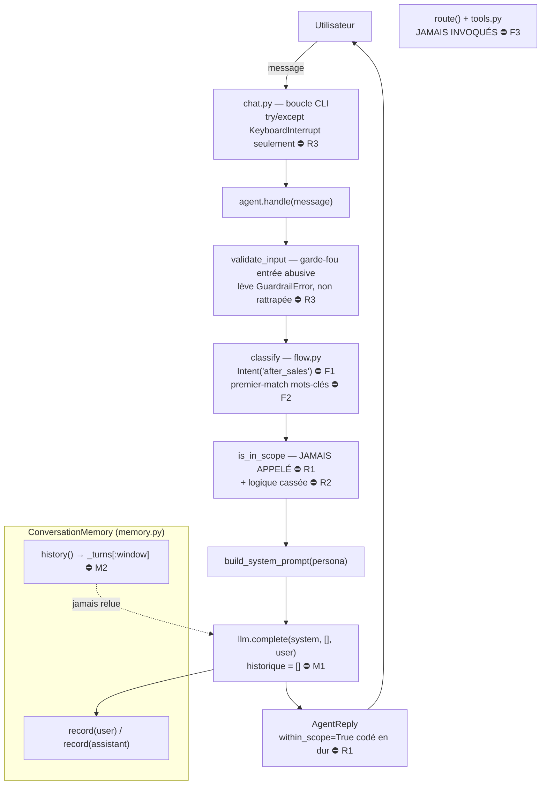

# Note de diagnostic — Agent Velmo « qui oublie et qui dérape »

> Livrable 1 (conception préliminaire) : note de diagnostic + schéma de l'agent.
> **Statut : BROUILLON à valider.**

## 1. Contexte & objectif

L'agent de support Velmo est en production. Deux plaintes récurrentes :
1. il **oublie** ce que le client a dit quelques messages plus tôt ;
2. il **sort de son rôle** (réponses hors périmètre, entrées douteuses mal gérées).

Par ailleurs, le **flux métier a évolué** : retours et remboursements doivent
désormais être traités par un **parcours après-vente unifié**.

Objectif de cette note : **délimiter le périmètre du problème** en distinguant
ce qui relève d'un **défaut de mémoire** de ce qui relève d'une **sortie de rôle**
(+ l'écart de **flux métier**), preuves à l'appui, avant toute correction.

## 2. Méthode

Démarche de diagnostic en 3 temps, appliquée à chaque cas problématique :
**observer le symptôme** (reproduction dans le chat) → **formuler une hypothèse**
→ **vérifier dans le code**. Aucune correction n'est faite à ce stade.

Matériel : les 5 conversations de `data/conversations_problematiques.json`,
rejouées sur l'agent réel (après déblocage de 2 erreurs de configuration —
voir annexe).

## 3. Périmètre du problème : 3 axes

```text
+----------------------+--------------------------------------------------+--------------------------------------------------+
| Axe                  | Question                                         | Cas concernés                                    |
+======================+==================================================+==================================================+
| A. MÉMOIRE           | L'agent tient-il le contexte sur plusieurs tours | `ctx-oubli-1`                                    |
|                      | ?                                                |                                                  |
+----------------------+--------------------------------------------------+--------------------------------------------------+
| B. RÔLE / GARDE-FOUS | Refuse-t-il proprement le hors-périmètre et les  | `perimetre-1`, `perimetre-2`, `entree-abusive-1` |
|                      | entrées abusives ?                               |                                                  |
+----------------------+--------------------------------------------------+--------------------------------------------------+
| C. FLUX MÉTIER       | Le routage correspond-il au nouveau parcours     | `apres-vente-1`                                  |
|                      | après-vente ?                                    |                                                  |
+----------------------+--------------------------------------------------+--------------------------------------------------+
```

**Le périmètre mémoire ≠ rôle est explicite** : l'oubli est un défaut de
*transmission du contexte* au modèle ; les sorties de rôle sont des défauts de
*garde-fous* (filtrage entrée + contrôle de périmètre). Les deux sont
indépendants et se corrigent séparément.

## 4. Constats détaillés

### Axe A — Mémoire (« qui oublie »)

```text
+-----+-----------------------------+-----------------------------------+----------------+-----------------------------------+
| Réf | Défaut                      | Cause technique                   | Localisation   | Effet observé                     |
+=====+=============================+===================================+================+===================================+
| M1  | Historique jamais réinjecté | La mémoire est écrite (`record`)  | `agent.py:52`  | À chaque tour l'agent repart de   |
|     |                             | mais jamais relue : on passe `[]` |                | zéro ; il oublie la commande 4521 |
|     |                             | au modèle au lieu de              |                | dès le tour suivant               |
|     |                             | `self.memory.history()`           |                |                                   |
+-----+-----------------------------+-----------------------------------+----------------+-----------------------------------+
| M2  | Fenêtre glissante inversée  | `history()` renvoie               | `memory.py:26` | Bug LATENT : même M1 corrigé, le  |
|     |                             | `self._turns[:window]` (les tours |                | contexte récent serait perdu dans |
|     |                             | les plus ANCIENS) au lieu de      |                | une longue conversation           |
|     |                             | `self._turns[-window:]` (les plus |                |                                   |
|     |                             | RÉCENTS)                          |                |                                   |
+-----+-----------------------------+-----------------------------------+----------------+-----------------------------------+
```

**Preuve (M1)** — conversation rejouée :
> T1 « ma commande 4521 est en retard » → T3 « ma première commande 4521 est
> arrivée ? » → l'agent répond comme s'il découvrait la 4521, sans mémoire du
> « en retard » annoncé au T1.

**Mécanisme de mémoire :** présent mais **débranché**. Le composant
`ConversationMemory` existe et fonctionne ; c'est le *câblage* mémoire → modèle
qui est coupé (M1), et la sélection des tours qui est erronée (M2).

### Axe B — Rôle / garde-fous (« qui dérape »)

```text
+-----+----------------------------+-----------------------------+-----------------------------+-----------------------------+
| Réf | Défaut                     | Cause technique             | Localisation                | Effet observé               |
+=====+============================+=============================+=============================+=============================+
| R1  | Contrôle de périmètre non  | `is_in_scope` est importé   | `agent.py:51-59`            | Le refus du hors-sujet      |
|     | branché                    | mais jamais appelé ;        |                             | (cookies, bourse) repose    |
|     |                            | `within_scope=True` est     |                             | uniquement sur le prompt    |
|     |                            | codé en dur                 |                             | système : non garanti,      |
|     |                            |                             |                             | contournable                |
+-----+----------------------------+-----------------------------+-----------------------------+-----------------------------+
| R2  | `is_in_scope` cassée       | La fonction boucle sur les  | `scope.py:23`               | Même branchée, elle         |
|     |                            | mots du message au lieu de  |                             | laisserait tout passer      |
|     |                            | `IN_SCOPE_TOPICS` ->        |                             |                             |
|     |                            | renvoie toujours `True`     |                             |                             |
+-----+----------------------------+-----------------------------+-----------------------------+-----------------------------+
| R3  | Garde-fou abusif non       | `validate_input` lève       | `agent.py:48` +             | L'entrée "imbécile" est     |
|     | rattrapé                   | `GuardrailError`, mais      | `chat.py:16-23`             | bien détectée mais fait     |
|     |                            | aucun `try/except` ne       |                             | planter l'application au    |
|     |                            | l'intercepte (ni `handle`,  |                             | lieu d'un refus poli        |
|     |                            | ni la boucle chat)          |                             |                             |
+-----+----------------------------+-----------------------------+-----------------------------+-----------------------------+
```

**Nuance importante** : pour cookies/bourse, l'agent *semble* bien refuser — mais
c'est le **modèle** qui obéit au prompt, pas un garde-fou déterministe. Le code
de contrôle de périmètre est soit débranché (R1), soit inopérant (R2).

### Axe C — Flux métier (parcours après-vente)

```text
+-----+-----------------------------+-----------------------------+----------------------------+-----------------------------+
| Réf | Défaut                      | Cause technique             | Localisation               | Effet observé               |
+=====+=============================+=============================+============================+=============================+
| F1  | Refactor après-vente        | `_KEYWORDS` mappe           | `flow.py:12-17` vs `29-32` | "Je veux un remboursement"  |
|     | incomplet                   | retour/remboursement ->     |                            | FAIT PLANTER l'application  |
|     |                             | `"after_sales"`, mais       |                            |                             |
|     |                             | l'enum `Intent` n'a PAS de  |                            |                             |
|     |                             | membre `AFTER_SALES` (il    |                            |                             |
|     |                             | garde `RETURN`/`REFUND`) -> |                            |                             |
|     |                             | `Intent("after_sales")`     |                            |                             |
|     |                             | lève `ValueError`           |                            |                             |
+-----+-----------------------------+-----------------------------+----------------------------+-----------------------------+
| F2  | Mots-clés à premier-match   | "commande" est testé avant  | `flow.py:21-51`            | "remboursement POUR LA      |
|     |                             | "remboursement"             |                            | COMMANDE 4490" est mal      |
|     |                             |                             |                            | classé en `order_status` au |
|     |                             |                             |                            | lieu d'après-vente          |
+-----+-----------------------------+-----------------------------+----------------------------+-----------------------------+
| F3  | Routage non câblé           | `handle()` appelle          | `agent.py:46-60`           | `classify` ne sert qu'à     |
|     |                             | `classify()` mais jamais    |                            | étiqueter `category` ;      |
|     |                             | `route()` ni les outils de  |                            | aucun outil métier n'est    |
|     |                             | `tools.py` ; la réponse     |                            | réellement invoqué          |
|     |                             | vient toujours du LLM seul  |                            |                             |
+-----+-----------------------------+-----------------------------+----------------------------+-----------------------------+
```

**Intention correcte, implémentation incohérente** : le besoin métier (unifier
retour + remboursement) est bien présent dans les mots-clés, la docstring de
`flow.py` et l'outil `open_after_sales` — mais l'enum et le câblage n'ont pas
suivi.

## 5. Schéma de l'agent (flux + mémoire + garde-fous)

État **actuel** du pipeline. Les ⛔ marquent les points défaillants identifiés.



### Version ASCII (secours)

```text
Utilisateur
    | message
    v
[chat.py] boucle CLI -- try/except = KeyboardInterrupt seulement  [!]R3
    |
    v
[agent.handle]
    |
    +-> validate_input  (garde-fou entrée) -- lève GuardrailError, NON rattrapée  [!]R3
    |
    +-> classify (flow)  -- Intent("after_sales") => ValueError  [!]F1
    |                       premier mot-clé gagne ("commande" masque "remboursement")  [!]F2
    |
    +-> is_in_scope  -- JAMAIS APPELÉE [!]R1  +  logique cassée (toujours True) [!]R2
    |
    +-> build_system_prompt(persona)
    |
    +-> llm.complete(system, [] , user)  -- historique = [] (mémoire débranchée)  [!]M1
    |
    +-> memory.record(user) / record(assistant)   [écrit OK]
    |        memory.history() => _turns[:window]  -- fenêtre inversée  [!]M2
    |        (... mais jamais relue par le LLM)
    |
    +-> AgentReply(within_scope=True codé en dur [!]R1)
            |
            v
        Utilisateur

route() + tools.py  -- JAMAIS INVOQUÉS  [!]F3
```

## 6. Synthèse & cap

Les trois axes sont **indépendants** et alignés sur les 3 critères de performance :

```text
+-------------------------------------------+------------+--------------------+
| Critère de performance attendu            | Axe        | Défauts à corriger |
+===========================================+============+====================+
| Tenir le contexte multi-tours             | A. Mémoire | M1, M2             |
+-------------------------------------------+------------+--------------------+
| Rester dans son rôle / refuser proprement | B. Rôle    | R1, R2, R3         |
+-------------------------------------------+------------+--------------------+
| Flux conforme au nouveau besoin métier    | C. Flux    | F1, F2, F3         |
+-------------------------------------------+------------+--------------------+
```

> Cette note **délimite** le problème. La correction fera l'objet des étapes
> suivantes du brief.

---

### Annexe — Erreurs de configuration corrigées pour pouvoir reproduire

```text
+----+---------------------------------+------------------------------------------+------------------------------------------+
| #  | Erreur                          | Cause                                    | Correctif appliqué                       |
+====+=================================+==========================================+==========================================+
| C1 | `KeyError: 'AZURE_AI_ENDPOINT'` | nom de variable d'env incohérent         | `config.py` -> lire                      |
|    |                                 |                                          | `AZURE_AI_INFERENCE_ENDPOINT`            |
+----+---------------------------------+------------------------------------------+------------------------------------------+
| C2 | `KeyError: 'persona'`           | placeholder `{persona}` vs               | `prompts.py` ->                          |
|    |                                 | `.format(role=...)`                      | `.format(persona=persona)`               |
+----+---------------------------------+------------------------------------------+------------------------------------------+
```

*(Ces deux corrections étaient des blocages d'amorçage, distincts des 7 défauts
fonctionnels ci-dessus.)*
