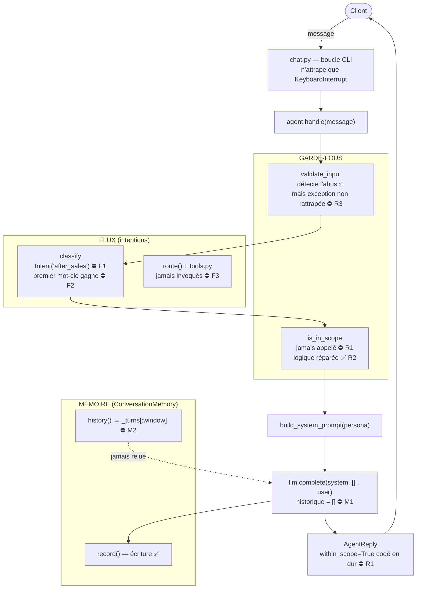

# Note de diagnostic — Agent Velmo

**Étape 1 du brief — Diagnostiquer oublis et sorties de rôle**

> Objectif (énoncé) : *à partir des conversations problématiques fournies, définir
> le périmètre du problème en distinguant les **défauts de mémoire** des
> **sorties de rôle**.*
> Livrable : note de diagnostic + schéma de l'agent (flux + mémoire + garde-fous).
> **Statut : à valider.**

---

## 0. Méthode

Chaque conversation problématique de `data/conversations_problematiques.json` a été
**rejouée sur l'agent réel**, puis analysée selon la démarche :
**symptôme observé → hypothèse → vérification dans le code**.

---

## 1. Périmètre du problème (mémoire vs rôle)

Le périmètre se partage en **deux familles de défauts indépendantes**, plus un
écart de flux métier traité à part.

| Famille | Nature du défaut | Où ça se joue | Cas concernés |
|---|---|---|---|
| **A. Mémoire** | Le contexte des tours précédents n'est pas transmis au modèle | Mémoire ↔ appel modèle | `ctx-oubli-1` |
| **B. Rôle (garde-fous)** | Les entrées hors-périmètre / abusives ne sont pas filtrées proprement | Garde-fous entrée + contrôle de périmètre | `perimetre-1`, `perimetre-2`, `entree-abusive-1` |
| **C. Flux métier** *(connexe)* | Le routage ne correspond pas au nouveau parcours après-vente | Classification d'intention | `apres-vente-1` |

> **Distinction clé.** Un **défaut de mémoire** = problème de *transmission du
> contexte* (l'agent *pourrait* bien répondre, mais on ne lui donne pas
> l'historique). Une **sortie de rôle** = problème de *garde-fou* (l'agent
> accepte/traite ce qu'il devrait refuser). Ce sont deux causes, deux endroits,
> deux corrections séparées.

---

## 2. Caractérisation des OUBLIS (axe mémoire)

### 2.1 Oublis observés

Conversation `ctx-oubli-1` rejouée :

| Tour | Message client | Réponse de l'agent | Mémoire ? |
|---|---|---|---|
| 1 | « ma commande **4521** est en retard » | accuse réception, demande l'e-mail | — |
| 2 | « et la précédente, la **4490** ? » | répond sur la 4490, **aucun lien** avec la 4521 | ❌ |
| 3 | « finalement, ma première commande, la **4521**, est arrivée ? » | répond **comme s'il découvrait** la 4521 ; a oublié le « en retard » du tour 1 | ❌ |

**Symptôme caractérisé :** l'agent est **sans état (stateless)** du point de vue
du modèle. Chaque message est traité **isolément** ; aucune information des tours
précédents n'est réutilisée. Le seul élément qui « persiste » (le numéro 4521)
n'est présent que parce que **le client le réécrit** lui-même.

### 2.2 Mécanisme de mémoire manquant / défaillant

Le composant mémoire **existe** (`ConversationMemory`, `memory.py`) et il est
même alimenté. Le défaut n'est donc pas l'absence de mémoire, mais son
**câblage** :

| Réf | Défaut | Mécanisme | Localisation |
|---|---|---|---|
| **M1** | Mémoire **jamais relue** | La conversation est *écrite* (`record`) mais on passe une liste vide `[]` au modèle au lieu de `self.memory.history()` → le modèle ne voit jamais l'historique | `agent.py:52` |
| **M2** | Fenêtre glissante **inversée** | `history()` renvoie `self._turns[:window]` (les tours les plus **anciens**) au lieu de `self._turns[-window:]` (les plus **récents**) | `memory.py:26` |

> Image : on prend des notes après chaque échange (`record`), mais on **ne rouvre
> jamais le carnet** au moment de répondre (`[]`). M1 est la cause active de
> l'oubli observé ; M2 est un défaut **latent** qui se révélerait après M1, sur
> les conversations longues.

---

## 3. Caractérisation des SORTIES DE RÔLE (axe garde-fous)

### 3.1 Sorties de rôle observées

| Cas | Entrée client | Comportement attendu | Comportement observé |
|---|---|---|---|
| `perimetre-1` | « recette de cookies ? » | refus poli (hors support) | refuse — **mais via le prompt seul**, pas un garde-fou |
| `perimetre-2` | « quel placement boursier ? » | refus (hors rôle) | refuse — **idem, non garanti** |
| `entree-abusive-1` | « imbécile » | rejet propre par le garde-fou | **l'application plante** (exception non gérée) |

**Symptôme caractérisé :** le maintien dans le rôle n'est **pas contrôlé par le
code**. Pour le hors-sujet, le refus dépend du bon vouloir du modèle face au
prompt (fragile, contournable). Pour l'entrée abusive, le garde-fou *se
déclenche* mais provoque un **crash** au lieu d'un refus courtois.

### 3.2 Mécanisme de garde-fous manquant / défaillant

| Réf | Défaut | Mécanisme | Localisation |
|---|---|---|---|
| **R1** | Contrôle de périmètre **non branché** | `is_in_scope` est importé mais jamais appelé dans `handle()` ; `within_scope=True` est codé en dur (le champ « ment ») | `agent.py:51-59` |
| **R2** | `is_in_scope` **défaillante** | La fonction bouclait sur les mots du message au lieu de `IN_SCOPE_TOPICS` → renvoyait toujours `True` *(corrigé en cours de diagnostic)* | `scope.py:23` |
| **R3** | Garde-fou abusif **non rattrapé** | `validate_input` lève `GuardrailError`, mais aucun `try/except` ne l'intercepte (ni `handle`, ni la boucle chat qui ne gère que `KeyboardInterrupt`) → crash | `agent.py:48` + `chat.py:16-23` |

> Le refus du hors-sujet ne doit pas reposer **uniquement** sur le prompt : il
> faut un garde-fou déterministe (R1 + R2). Et un garde-fou qui se déclenche doit
> produire un **refus**, pas une exception non gérée (R3).

---

## 4. Constat connexe — FLUX MÉTIER (`apres-vente-1`)

Hors dichotomie mémoire/rôle, mais relevé car bloquant. Le métier a unifié
**retour + remboursement** en un parcours **après-vente**. L'implémentation est
incohérente :

| Réf | Défaut | Mécanisme | Localisation |
|---|---|---|---|
| **F1** | Refactor **incomplet** | `_KEYWORDS` mappe vers `"after_sales"`, mais l'enum `Intent` n'a pas de membre `AFTER_SALES` → `Intent("after_sales")` lève `ValueError` (crash sur « je veux un remboursement ») | `flow.py:12-17` vs `29-32` |
| **F2** | Mots-clés **premier-match** | « commande » testé avant « remboursement » → « remboursement pour la commande 4490 » mal classé en `order_status` | `flow.py:21-51` |
| **F3** | Routage **non câblé** | `handle()` appelle `classify()` mais jamais `route()` ni les outils ; aucun outil métier n'est réellement invoqué | `agent.py:46-60` |

---

## 5. Schéma de l'agent (flux + mémoire + garde-fous)

État **actuel**. Les ⛔ pointent les défauts ; les ✅ ce qui fonctionne.



### Version ASCII (secours)

```
Client ──message──> [chat.py] (try/except = KeyboardInterrupt seulement)
                        │
                        ▼
                 [agent.handle]
                        │
   GARDE-FOUS ──► validate_input  ── abus détecté ✅ / exception non rattrapée ⛔R3
                        │
   FLUX ─────────► classify  ── Intent("after_sales") => crash ⛔F1 / 1er mot-clé gagne ⛔F2
                        │
   GARDE-FOUS ──► is_in_scope  ── jamais appelé ⛔R1 / logique réparée ✅R2
                        │
                  build_system_prompt(persona)
                        │
                        ▼
              llm.complete(system, [], user)  ── historique = []  ⛔M1
                        │
   MÉMOIRE ────► record() écrit ✅   |   history() => _turns[:window] ⛔M2
                        │                (… jamais relue par le LLM)
                        ▼
              AgentReply(within_scope=True en dur ⛔R1)  ──► Client

   route() + tools.py  ── JAMAIS INVOQUÉS ⛔F3
```

---

## 6. Synthèse — périmètre explicite & cap

| Axe | Critère de performance visé | Défauts |
|---|---|---|
| **Mémoire** | Tenir le contexte multi-tours | M1, M2 |
| **Rôle** | Rester dans son rôle / refuser proprement | R1, R2, R3 |
| **Flux métier** *(connexe)* | Flux conforme au nouveau besoin | F1, F2, F3 |

**Conclusion.** Le périmètre est **explicitement scindé** : un problème de
**mémoire** (contexte non transmis) et un problème de **rôle** (garde-fous
absents/inopérants/non rattrapés), distincts dans leur cause comme dans leur
localisation. La correction fera l'objet de l'étape suivante.

---

### Annexe — blocages d'amorçage corrigés (pour pouvoir reproduire)

| # | Erreur | Cause | Correctif |
|---|---|---|---|
| C1 | `KeyError: 'AZURE_AI_ENDPOINT'` | nom de variable d'env incohérent | `config.py` → `AZURE_AI_INFERENCE_ENDPOINT` |
| C2 | `KeyError: 'persona'` | placeholder `{persona}` vs `.format(role=...)` | `prompts.py` → `.format(persona=persona)` |
