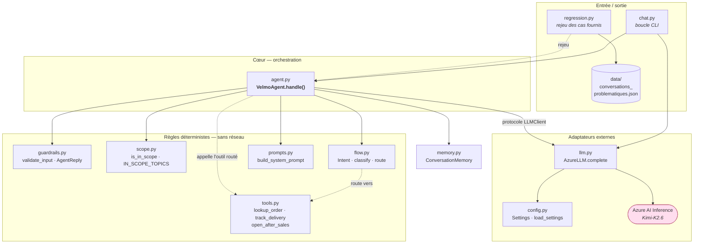
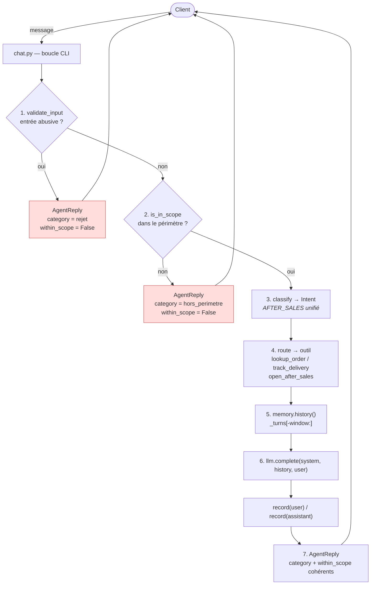
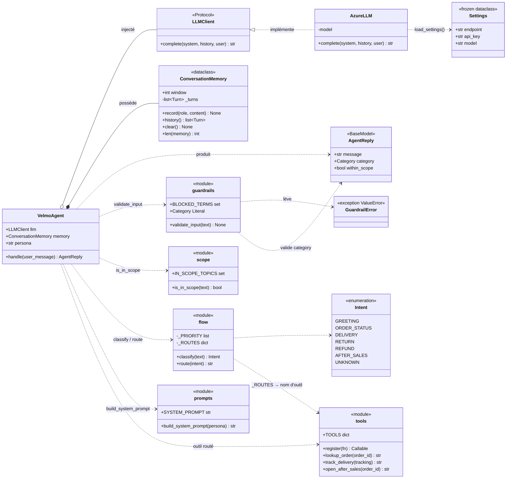
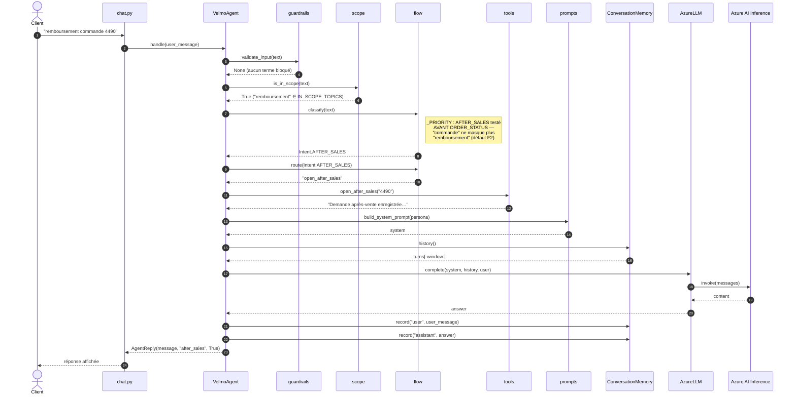
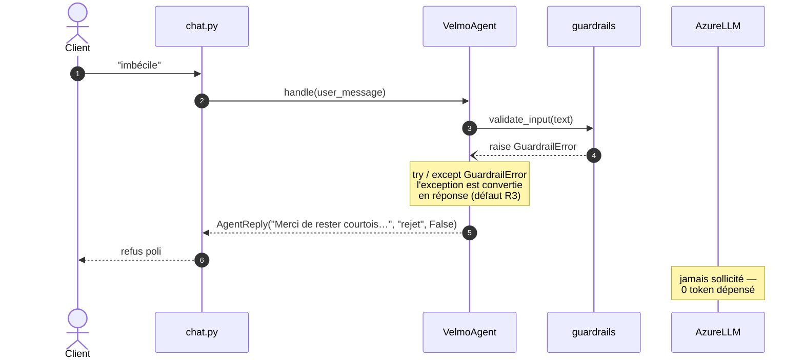
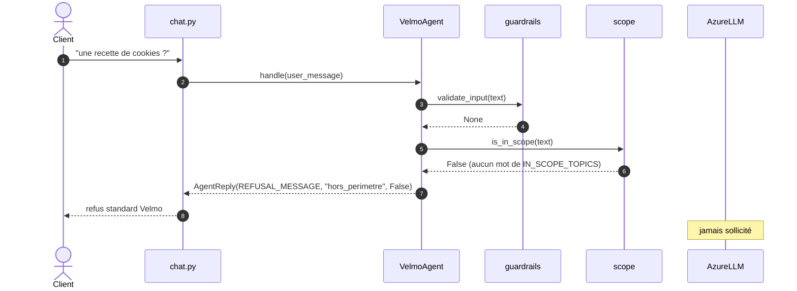
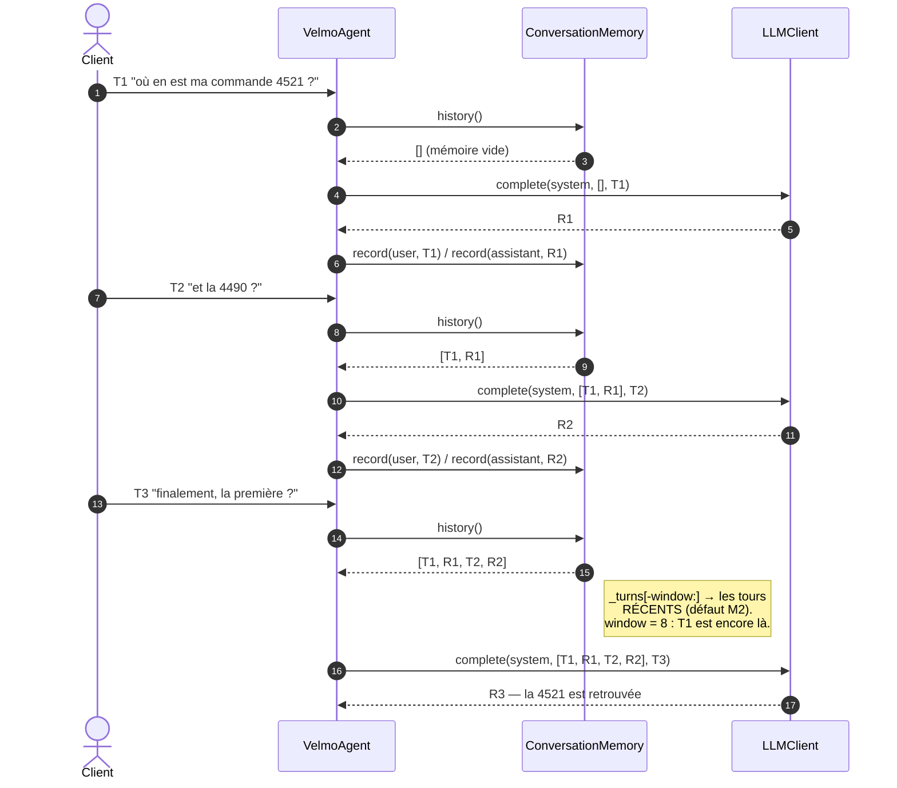
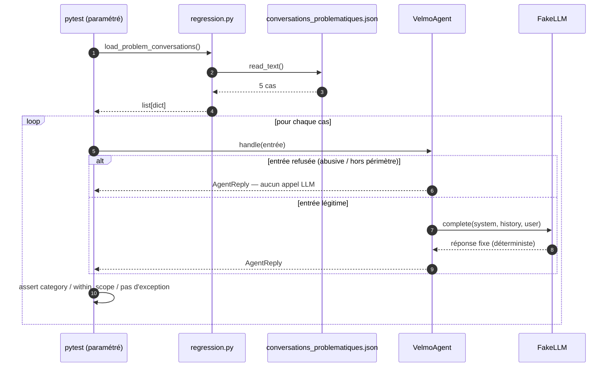

# Schémas Mermaid — architecture, classes, séquences

Versions Mermaid des schémas ASCII de [cadrage_flux_cible.md](cadrage_flux_cible.md).
Chaque bloc se colle tel quel dans [mermaid.live](https://mermaid.live) (Mermaid
Live Editor), dans un README GitHub ou dans la prévisualisation Markdown de VS Code.

> **Périmètre.** §1 à §3 décrivent la **cible** (le flux tel qu'il doit être).
> §4 décrit l'**état réel du code** au moment de la rédaction, pour que l'écart
> soit visible plutôt que sous-entendu.

---

## 1. Architecture — modules et dépendances

Vue statique : qui dépend de qui. `agent.py` est le seul point d'assemblage ;
les modules de règles (`guardrails`, `scope`, `flow`) ne dépendent de rien —
c'est ce qui les rend testables sans réseau.



**Lecture.** La frontière `RULES` / `EXT` est le point clé : tout ce qui décide
d'un refus est à gauche (déterministe, gratuit, testable) ; tout ce qui coûte un
appel réseau est à droite. `VelmoAgent` ne connaît le LLM que par le protocole
`LLMClient`, ce qui autorise un double (`FakeLLM`) dans les tests.

---

## 2. Flux cible — parcours d'un message

Version Mermaid du schéma §A.5.



---

## 3. Diagramme de classes

Ce qui est réellement une classe dans le code : `VelmoAgent`, `ConversationMemory`,
`AgentReply`, `AzureLLM`, `Settings`, plus deux types (`Intent`, `GuardrailError`)
et le protocole `LLMClient`. Les modules purement fonctionnels (`scope`, `flow`,
`prompts`, `tools`) sont représentés comme utilitaires `<<module>>`.



### 3.1 Points de conception à retenir

- `VelmoAgent o-- LLMClient` (agrégation) : le client est **injecté**, l'agent ne
  le crée pas — condition du test hors-réseau.
- `VelmoAgent *-- ConversationMemory` (composition) : si aucune mémoire n'est
  fournie, l'agent en crée une ; sa durée de vie est celle de l'agent.
- `Category` est un `Literal` Pydantic : toute `category` hors liste fait échouer
  la construction d'`AgentReply` — la sortie est **contrainte par le type**.

---

## 4. Diagrammes de séquence

### 4.1 Cas nominal — « remboursement commande 4490 » (après-vente unifié)

Le parcours complet, tous les garde-fous franchis. C'est la séquence **cible** :
elle inclut l'étape 4 (routage vers `open_after_sales`).



### 4.2 Court-circuit 1 — entrée abusive

Aucun appel LLM, aucune exception qui remonte : le refus est une **réponse
structurée**, pas un crash.



### 4.3 Court-circuit 2 — hors périmètre



### 4.4 Mémoire sur 3 tours — cas `ctx-oubli-1`

Ce que le test de non-régression doit observer : au 3ᵉ tour, l'historique passé
au LLM est **non vide** et contient le tour 1.



### 4.5 Harnais de non-régression



---

## 5. Écart entre ces schémas et le code actuel

Les séquences §4 décrivent la **cible**. Vérification faite dans `src/velmo/`
à la date de rédaction :

```text
+--------------------------------------------------------+-----------------------------+-------------------+
| Étape du flux                                          | Code actuel                 | Statut            |
+========================================================+=============================+===================+
| 1. `validate_input` + `try/except GuardrailError`      | présent dans `handle`       | conforme (R3)     |
+--------------------------------------------------------+-----------------------------+-------------------+
| 2. `is_in_scope` bouclant sur `IN_SCOPE_TOPICS`        | présent                     | conforme (R2)     |
+--------------------------------------------------------+-----------------------------+-------------------+
| 3. `Intent.AFTER_SALES` + `_PRIORITY`                  | présents                    | conforme (F1, F2) |
+--------------------------------------------------------+-----------------------------+-------------------+
| 4. `route()` / `tools`                                 | JAMAIS APPELÉS par `handle` | ÉCART F3 OUVERT   |
+--------------------------------------------------------+-----------------------------+-------------------+
| 5. `memory.history()` passé au LLM, `_turns[-window:]` | présents                    | conforme (M1, M2) |
+--------------------------------------------------------+-----------------------------+-------------------+
| 7. `within_scope` reflétant le résultat                | présent                     | conforme (R1)     |
+--------------------------------------------------------+-----------------------------+-------------------+
```

Deux points à trancher lors de la validation du cadrage :

1. **Ordre des étapes 2 et 3.** Le cadrage place le contrôle de périmètre
   **avant** la classification. `handle` fait l'inverse : il classifie d'abord et
   n'appelle `is_in_scope` que si l'intention est `UNKNOWN`. Le résultat est
   équivalent sur les 5 cas fournis, mais le schéma §2 et le code divergent.
2. **Nom de la catégorie de refus.** Le cadrage écrit `hors_perimetre` ; le code
   renvoie `"refusal"`, seule valeur autorisée par le `Literal` `Category` de
   `guardrails.py`. Il faut aligner les deux — soit le document, soit le type.
